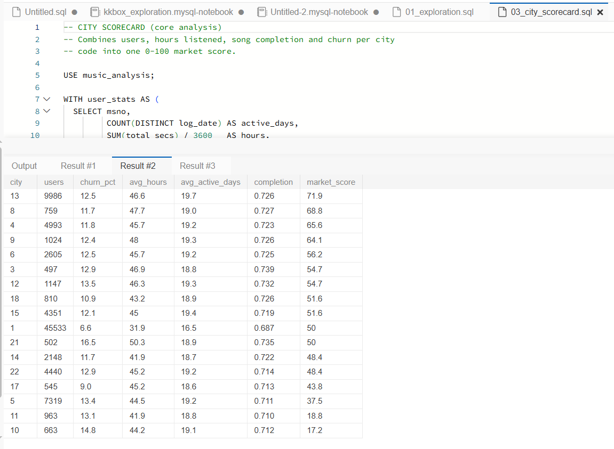

# Music Streaming Analysis: Which City Codes Are the Strongest Markets?

A SQL and Python analysis of music streaming data from KKBox, an Asian streaming service. It ranks city codes by user base, engagement, listening completion and subscriber churn, and ends with a market recommendation.

**Tools:** MySQL 8 (CTEs, window functions, views), Python (pandas, SQLAlchemy, PyMySQL), Git/GitHub

---

## Business question

> Which city codes are the strongest markets for a streaming service to invest in (marketing, local content, partnerships), judged on user base size, engagement, listening completion and subscriber churn?

## Dataset

- **Source:** [KKBox Churn Prediction Challenge (Kaggle)](https://www.kaggle.com/c/kkbox-churn-prediction-challenge/data)
- **Files used:** `train_v2.csv` (churn label per user), `members_v3.csv` (city, age, gender), `user_logs_v2.csv` (daily listening activity)
- **Period covered by the logs:** 1 to 31 March 2017
- **Sample:** 100,000 users drawn at random (`random_state=42`), with the matching member and log rows for those users
- **Data is not included in this repo.** Download it from Kaggle (a free account is required, and you must accept the competition rules).

**Note on cities:** the dataset stores city as an anonymous numeric code, not a name. All results refer to "city codes".

### Sample size after loading

| Table | Rows |
|---|---|
| `train` | 100,000 |
| `members` | 88,726 |
| `user_logs` | 1,393,933 |

## Approach

1. **Sample** the data in Python, keeping the same 100,000 users across all three files so joins work.
2. **Load** the samples into MySQL.
3. **Explore and check quality** with SQL (counts, date range, churn balance, impossible values, duplicates, missing values).
4. **Clean** through a SQL view (`logs_clean`) that leaves the raw tables untouched.
5. **Score each city code** with a CTE-based scorecard that combines four metrics.
6. **Add a time view** with daily active users and a 7-day rolling average.

## Data quality findings

| Check | Result |
|---|---|
| Sampled users with no member record (so no city) | 11,274 (11.3%) |
| Sampled users with listening logs | 77,762 (77.8%) |
| Date range of logs | 1 to 31 March 2017 |
| Churn rate (`is_churn = 1`) | 9.0% (8,993 of 100,000 users) |
| Impossible log values (negative or over 24h per day) | 326 |
| Duplicate user-day log rows | 0 |
| Users with both a city and logs | 77,761 |

Cleaning rules in `logs_clean`: rows with `total_secs` outside 0 to 86,400 are removed, duplicate user-days are merged by summing, and the integer date (`20170301`) is converted to a real date.

## Method: the city scorecard

For each city code with at least 300 users, the scorecard calculates:

| Metric | Definition |
|---|---|
| `users` | Sampled users in that city code |
| `avg_hours` | Average hours listened per user in March |
| `completion` | Share of song plays that were played to the end (`num_100` divided by all plays) |
| `churn_pct` | Percentage of users labelled as churned in the dataset |

Each metric is converted to a position from 0 to 1 with `PERCENT_RANK()` (for churn, lower is better, so it uses `1 - rank`). The four positions are averaged with **equal weights** and multiplied by 100 to give a `market_score` from 0 to 100.

**Churn definition:** churn is the dataset's own label (a subscriber who did not renew after their subscription expired), not a definition chosen in this project. See the Kaggle data page for the exact rule.

## Results

### City scorecard



## Key findings

17 city codes had at least 300 sampled users and are scored (about 88,285 of the 88,726 sampled members; roughly 441 users sit in smaller city codes that were excluded).

- **Top market: city code 13.** It has the highest score (71.9), the second-largest user base (9,986), the most active days per user (19.7), 46.6 listening hours per user and 12.5% churn.
- **Strong, smaller markets: city codes 8, 4 and 9** (scores 68.8, 65.6 and 64.1). City codes 8 and 9 have the highest listening time (47.7 and 48.0 hours) but only 759 and 1,024 users. City code 4 combines a mid-sized base (4,993 users) with 45.7 hours and 11.8% churn.
- **The biggest trade-off is city code 1.** It holds about 52% of the sampled users (45,533) and has the lowest churn (6.6%), but also the lowest engagement: 31.9 hours, 16.5 active days and 0.687 completion, against roughly 42 to 50 hours in the other city codes. It scores exactly 50.0, because it ranks first on size and churn but last on hours and completion.
- **Weakest markets: city codes 10 and 11** (scores 17.2 and 18.8). Both are small, with the lowest completion rates (0.712 and 0.710) and above-average churn (14.8% and 13.1%). City code 5 is also worth attention: it has 7,319 users but a below-average score (37.5), with 13.4% churn and 0.711 completion.
- **High churn can sit alongside high engagement.** City code 21 has the highest churn (16.5%) and the highest listening time (50.3 hours), but only 502 users.
- **Engagement gaps between most city codes are small.** Outside city code 1, completion only ranges from 0.710 to 0.739, so many rank differences come from small gaps. The order is a guide, not a precise ranking.

## Recommendation

Prioritise **city code 13** as the lead growth market, since it combines a large user base with high engagement. Pair it with **city codes 4, 8 and 9**, which show strong listening time and moderate churn and are good candidates for targeted marketing or local content. In **city code 1**, the largest market, focus on raising engagement rather than acquiring users, because churn is already the lowest but listening time is well below every other city code. Treat **city codes 5, 10 and 11** as retention priorities. Confidence is moderate: the data covers one month, the score uses equal weights, and many city codes differ only slightly on engagement.

## Limitations

- **One month of data (March 2017)**, so the results are a snapshot, not a long-term trend.
- **11% of sampled users have no member record** and about **22% have no listening logs**, so city-level engagement averages rest on a subset of users.
- **City codes are anonymous**, so the results can't be tied to named cities.
- **The score is rank-based**, so it ignores how large the gaps between city codes are. Small differences can move a city several places.
- **Equal weights in the score are a judgment call.** Different priorities (for example, weighting churn more heavily) could change the ranking.
- **Churn is the dataset's label**, which measures subscription renewal, not general listening activity.
- **Genre is not available** in this dataset, so genre preferences were not analysed.
- Results come from a **random sample of 100,000 users**, not the full user base.

## Repository structure

```
music-streaming-sql-analysis/
├── README.md
├── sql/
│   ├── 01_exploration.sql
│   ├── 02_clean_view.sql
│   ├── 03_city_scorecard.sql
│   └── 04_daily_trend.sql
├── notebooks/
│   └── analysis.ipynb
└── images/
    └── scorecard.png
```

## How to reproduce

1. Download `train_v2.csv`, `members_v3.csv` and `user_logs_v2.csv` from the Kaggle page above and unzip them into one folder.
2. Install the Python libraries: `pip install pandas sqlalchemy pymysql`.
3. Start MySQL 8 on your computer.
4. Open `notebooks/analysis.ipynb` and run the cells in order to sample the data, connect to MySQL (the password is requested when you run the cell), create the tables and load the data.
5. In MySQL Workbench, run the SQL files in order: `01` to `04`.

## Skills demonstrated

- SQL: joins, CTEs, window functions (`PERCENT_RANK`, rolling `AVG`), views, aggregation, data quality checks
- Python: pandas chunked reading, sampling, SQLAlchemy loading
- Analysis: defining a business question, building a scoring framework, documenting limitations, making a recommendation

## Author

**Aayush Chandrakar**
[LinkedIn](https://www.linkedin.com/in/aayuchan) | [GitHub](https://github.com/aayush2405)
